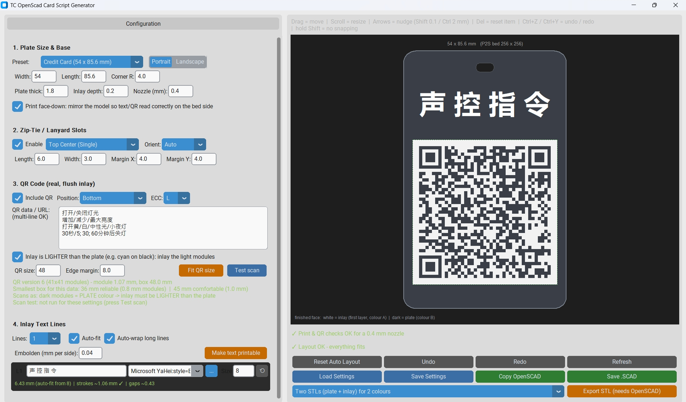

# 🏷️ TC OpenSCAD Card Script Generator

An interactive desktop designer for printable cards, asset tags, and lanyard badges optimized for dual-colour 3D printing (Bambu Lab P2S / AMS, 256 × 256 mm bed).

Generates production-ready OpenSCAD scripts with flush two-colour inlays, auto-fitted text metrics, zip-tie lanyard slots, and camera-scannable QR codes.

  

## ✨ Key Features

* **Flush Inlay Architecture:** Text and QR code form the first layer (0.20 mm) printed face-down on the build plate in Colour A; the structural card body forms Colour B.
* **Nozzle-Aware Verification:** Automatically evaluates stroke widths and clearances against a standard 0.4 mm nozzle to prevent unprintable text or unreadable QR modules.
* **Simulated Optical Scanner:** Integrated CV model verifies whether your printed QR code will decode reliably under real-world camera conditions.
* **True-Type Font Layout:** Automatic line-wrapping, font metrics calculations, and per-glyph stroke emboldening.
* **One-Click Multi-STL Export:** Connects directly with the OpenSCAD CLI to export aligned `_1_inlay.stl` and `_2_plate.stl` dual-part files ready for Bambu Studio.

  
### Note for Malaysian supporters 🇲🇾

For supporters in Malaysia: Should you wish to support our initiative through a local funds transfer, the DuitNow QR code below is available for your convenience.

  

